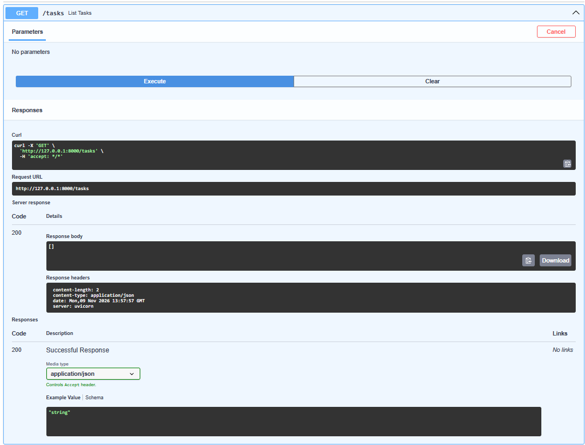
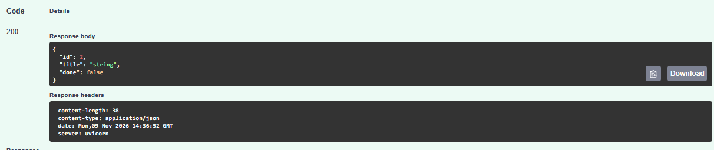
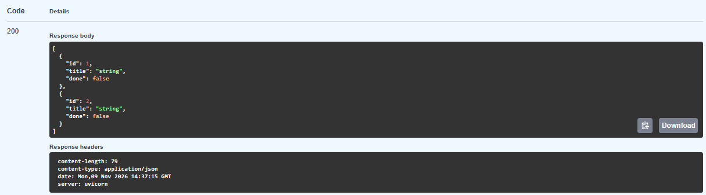
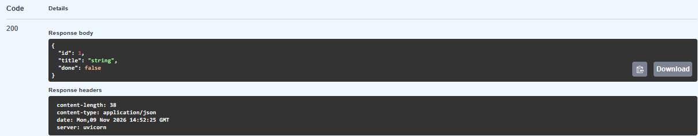
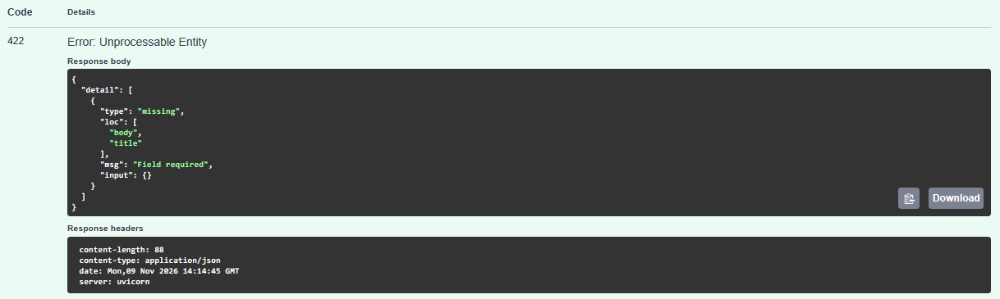
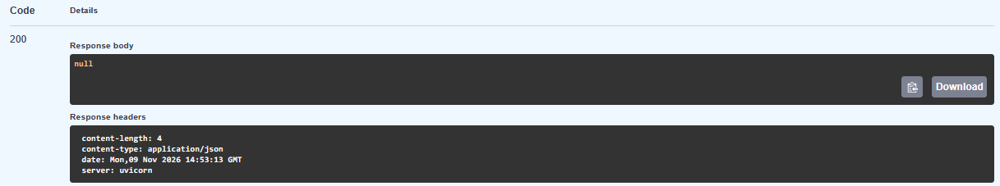
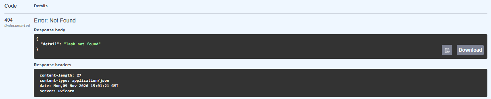
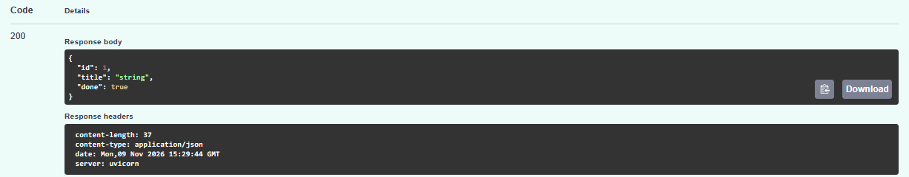
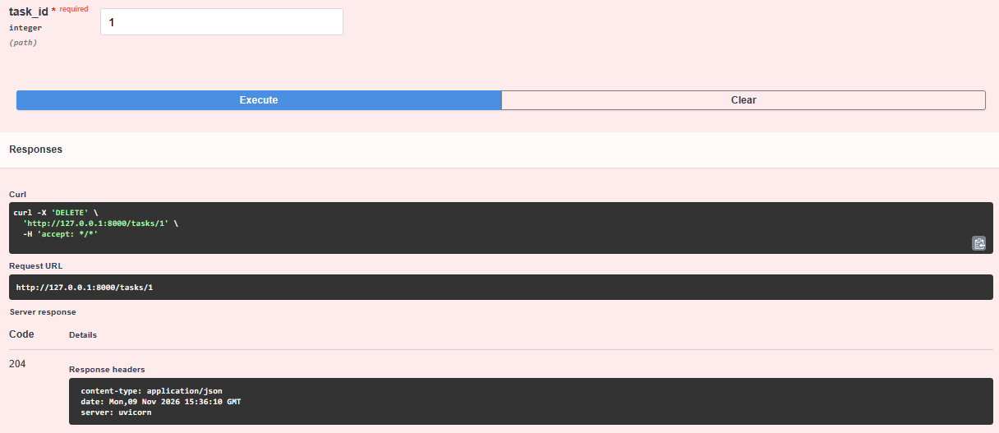
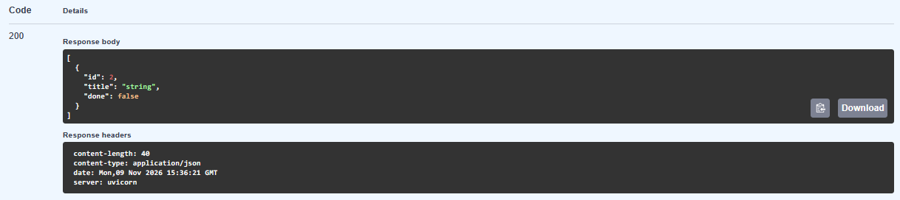

# Simple FastAPI Demo

I built a small to-do API to learn how FastAPI handles requests, validates JSON, and sends responses. I added and tested each route in Swagger UI before moving on to the next one.

Tasks live in a Python dictionary called `todo_db`, keyed by ID. The tasks and the ID counter reset when the server restarts.

## Run locally

Install Python 3.11 or newer, then open PowerShell in the project folder and run:

```powershell
python -m venv .venv
.\.venv\Scripts\python.exe -m pip install -r requirements.txt
.\.venv\Scripts\python.exe -m uvicorn main:app --reload
```

Leave the server running and open [Swagger UI](http://127.0.0.1:8000/docs). Expand a route, click **Try it out**, fill in any requested fields, and click **Execute**.

## Endpoints

| Method | Path | What it does |
| --- | --- | --- |
| GET | `/tasks` | List all tasks |
| POST | `/tasks` | Create a task with a title and set `done` to `false` |
| GET | `/tasks/{task_id}` | Look up one task by ID |
| PATCH | `/tasks/{task_id}` | Set a task's completion status to `true` or `false` |
| DELETE | `/tasks/{task_id}` | Remove a task by ID |

## Try a task from start to finish

1. Run **GET `/tasks`** after starting the server. The response is `[]`.
2. Send `{"title": "Buy groceries"}` with **POST `/tasks`**. Copy the `id` from the response.
3. Run **GET `/tasks/{task_id}`** with that ID to see the saved task.
4. Use **PATCH `/tasks/{task_id}`** with the same ID and send `{"done": true}` to mark it complete.
5. Use **DELETE `/tasks/{task_id}`** with the same ID. It returns `204 No Content`. A GET for that ID then returns `404 Not Found`.

## Verification and findings

I used the **Server response** section in Swagger UI to check what the app actually returned.

<details>
<summary>Read and create tasks</summary>

On a fresh start, GET returned `200` with an empty array. Running POST twice created two separate tasks with IDs `1` and `2`, even though both requests used Swagger's prefilled title, `"string"`. The list showed both records, and looking up ID `1` returned a single task object.









</details>

<details>
<summary>Handle invalid input and missing tasks</summary>

Sending `{}` to POST returned `422`. The response identified `title` as a required field in the request body.



My first lookup for a missing task returned `200` with `null` because the dictionary returned `None`. After I added an `HTTPException`, the same lookup returned `404` with `{"detail": "Task not found"}`.





</details>

<details>
<summary>Update and delete tasks</summary>

After I sent `{"done": true}` to PATCH, the task response showed `"done": true`. In a separate test, I created two tasks and deleted task `1`. DELETE returned `204` with an empty body, and a follow-up GET listed only task `2`.







</details>

## What I learned

- **Routes and HTTP methods.** FastAPI can use the same path for different actions. GET on `/tasks` reads the list, while POST on `/tasks` creates a task.
- **Request validation.** Pydantic models define the rules for incoming data. A missing required field produces a validation error before the route function runs.
- **Python objects and JSON.** My route returns Python data, and FastAPI turns it into a JSON response. For example, Python's `False` appears as `false` in JSON.
- **IDs and shared state.** The ID counter hands out the next ID, while the dictionary holds the tasks that currently exist. PATCH gets the saved task dictionary and changes its `done` field in place.
- **Response codes.** I used the response body and status code together to tell whether a request succeeded, failed validation, or referred to a missing task.
